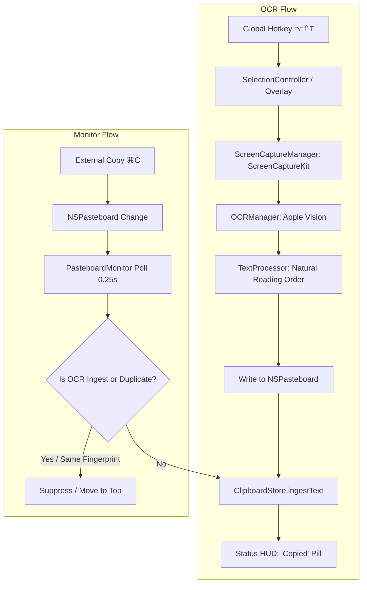

# Phase 0: Repository Assessment & Native Xcode Integration Plan

## 1. Workspace & Toolchain Assessment

### Current Toolchain Status
- **Active Developer Directory**: `/Applications/Xcode.app/Contents/Developer`
- **Xcode Version**: Xcode 27.0 (`Build version 27A266a`)
- **Swift Version**: Apple Swift version 6.4 (`swiftlang-6.4.0.34.1 clang-2100.3.34.1`)
- **SDK Path**: `/Applications/Xcode.app/Contents/Developer/Platforms/MacOSX.platform/Developer/SDKs/MacOSX.sdk`
- **Target Platform**: macOS 14.0+ (Sonoma) on Apple Silicon (`arm64`, MacBook Air M5)
- **Build System**: Native Xcode (`xcodebuild`) project and scheme

### Current Workspace State
- **Workspace Path**: `/Users/sameer/Code/ClipImageText`
- **Existing Files**:
  - `AGENTS.md`: Canonical project instructions, constraints, and architecture guidelines.
  - `phase 0.md`: Assessment and planning document (updated herein).
  - Temporary Swift Package Manager placeholders (`Package.swift`, `Sources/ClipTextCore/`, `Sources/ClipText/`): Created prior to Xcode installation as a temporary fallback; will be cleanly replaced in Phase 1 by the native `ClipText.xcodeproj` project.

---

## 2. Upstream Reference Repositories Assessment & Baseline Verification

Both upstream repositories have been inspected and verified using the native Xcode 27 toolchain.

### A. Primary Base: `Kelsiito/clipboard`
- **Repository**: [https://github.com/Kelsiito/clipboard](https://github.com/Kelsiito/clipboard)
- **License**: MIT License (Copyright © 2026 Kelsiito). Verified in `LICENSE`.
- **Xcode Structure**:
  - Project: `clipboard.xcodeproj`
  - Targets:
    1. `clipboard` (Native macOS Application, Bundle ID `com.kelsiito.clipboard`)
    2. `clipboardTests` (Unit Test Suite, Bundle ID `com.kelsiito.clipboardTests`)
  - Target Scheme: `clipboard`
  - Minimum Deployment Target: `macOS 14.0` (`MACOSX_DEPLOYMENT_TARGET = 14.0`)
  - Configurations: `Debug`, `Release`
  - App Type: Menu bar accessory app (`INFOPLIST_KEY_LSUIElement = YES`)
- **Dependencies**: Zero third-party dependencies (100% native Apple frameworks: SwiftUI, AppKit, Vision, ServiceManagement, Carbon, UniformTypeIdentifiers, CryptoKit).
- **Storage & Security**: AES-GCM encrypted local storage (`SecureLocalStorage.swift` / `LocalDataCipher` backing `history.json` and `snippets.json` in `~/Library/Application Support/clipboard`).
- **Baseline Build & Test Verification**:
  ```bash
  xcodebuild -project scratch/refs/clipboard/clipboard.xcodeproj -scheme clipboard -destination 'platform=macOS' test
  ```
  **Result**: `** TEST SUCCEEDED **`
  - 57 tests executed across store deduplication, AES-GCM encryption, search, retention, filters, and hotkey handling.
  - 0 failures, 100% pass rate.

### B. Screen-Region OCR Reference: `arsh342/TextGrab`
- **Repository**: [https://github.com/arsh342/TextGrab](https://github.com/arsh342/TextGrab)
- **License**: MIT License (Copyright © 2026 arsh342). Verified in `LICENSE`.
- **Xcode Structure**:
  - Project: `TextGrab.xcodeproj`
  - Targets:
    1. `TextGrab` (Native macOS Application)
    2. `TextGrabTests` (Unit & Performance Tests)
    3. `TextGrabUITests` (UI Test Suite)
  - Target Scheme: `TextGrab`
  - Minimum Deployment Target: `macOS 14.0`
- **Entitlements & Permissions**:
  - `TextGrab.entitlements`:
    - `com.apple.security.app-sandbox`: `false` (required for system-wide display capture and global hotkeys)
    - `com.apple.security.device.screen-capture`: `true`
  - `Info.plist`: `NSScreenCaptureUsageDescription`, `LSUIElement = true`.
  - `PermissionsManager.swift`: Handles `CGPreflightScreenCaptureAccess()` and `CGRequestScreenCaptureAccess()` with relaunch support.
- **Dependencies**: Zero third-party dependencies (ScreenCaptureKit, Vision, AppKit, SwiftUI).
- **Core Screen Selection & Vision OCR**:
  - `ScreenCaptureManager.swift`: ScreenCaptureKit multi-display capture with Retina backing-scale factor conversion and AppKit/ScreenCaptureKit coordinate inversion.
  - `SelectionController.swift`, `SelectionOverlayView.swift`, `SelectionWindowManager.swift`: Borderless floating overlay, smooth mouse-drag box selection, dimensions indicator, Esc-to-cancel, and auto-dismissing HUD feedback pill.
  - `OCRManager.swift` & `TextProcessor.swift`: High-accuracy Vision text recognition with dark-background CIColorInvert fallback, line grouping, and natural reading-order sorting.
- **Baseline Build & Test Verification**:
  ```bash
  xcodebuild -project scratch/refs/TextGrab/TextGrab.xcodeproj -scheme TextGrab -destination 'platform=macOS' test
  ```
  **Result**: `** TEST SUCCEEDED **`
  - 12 unit and performance tests passed (0 failures).
  - 2 UI tests passed (menu bar launch and primary actions).

### C. Architecture Reference: `tamibot/klip`
- **Repository**: [https://github.com/tamibot/klip](https://github.com/tamibot/klip)
- **License**: Apache-2.0 License (Copyright 2026 Martin Velasco O.) with `NOTICE`.
- **Key Insight**: Architectural boundary patterns separating screen capture, clipboard persistence, and UI presentation.

---

## 3. Licensing & Attribution Strategy

1. **ClipText Project License**: Permissive **MIT License**.
2. **Attributions Documentation**: `Documentation/UpstreamAttributions.md` will document:
   - Full MIT license and copyright notice for `Kelsiito/clipboard` (Copyright © 2026 Kelsiito).
   - Full MIT license and copyright notice for `arsh342/TextGrab` (Copyright © 2026 arsh342).
   - Architectural acknowledgment for `tamibot/klip` (Apache-2.0).
3. **Source Header Preservation**: Retain existing copyright notices and attributions in all imported source files.

---

## 4. Integration Architecture & Native Build Design

### Native Xcode Target & Scheme Structure
```text
ClipText.xcodeproj
├── Targets:
│   ├── ClipText (macOS Application, LSUIElement = YES, macOS 14.0+)
│   └── ClipTextTests (macOS Unit Test Bundle)
└── Schemes:
    └── ClipText (Build, Test, Run)
```

Standard build and test invocations:
```bash
# List project targets and schemes
xcodebuild -list -project ClipText.xcodeproj

# Build the native macOS application
xcodebuild -project ClipText.xcodeproj -scheme ClipText -destination 'platform=macOS' build

# Run unit tests
xcodebuild -project ClipText.xcodeproj -scheme ClipText -destination 'platform=macOS' test
```

### Unified Single-Ingestion Flow



### Deduplication Guarantee
To prevent duplicate history entries when ClipText writes OCR results to `NSPasteboard`:
1. `ClipboardStore.ingest(_:sourceApplication:)` accepts a `ClipboardSnapshot` and optional `ClipboardSourceApplication`. For OCR results, construct a `ClipboardSnapshot` from the recognized text and call `ingest` directly — no wrapper needed.
2. When OCR text is recognized:
   - `PasteboardMonitor.suppressCapture(for: 0.8)` is invoked, updating `lastChangeCount` immediately before writing to `NSPasteboard`.
   - **(New code, Phase 2/3)**: A SHA-256 fingerprint of the recognized text will be tracked in an in-memory set added to `PasteboardMonitor` as a secondary dedup guard.
   - `ClipboardStore`'s existing deduplication (`items.removeAll { $0.fingerprint == item.fingerprint }; items.insert(item, at: 0)`) moves repeated entries to the top, guaranteeing zero duplicate entries.

---

## 5. File-by-File Reuse & Adaptation Plan

| File | Origin Repository | Action | Rationale / Architectural Adjustments |
| :--- | :--- | :--- | :--- |
| **`ClipboardStore.swift`** | `clipboard` | **Adapt** | Core clipboard storage. Retain encrypted JSON persistence, retention policies, and search. Add explicit unified entry point `addText(_:source:)`. |
| **`PasteboardMonitor.swift`** | `clipboard` | **Adapt** | Retain 0.25s polling, concealed/transient marker filtering, pause monitoring. Add OCR write fingerprint deduplication. |
| **`Models.swift`** | `clipboard` | **Adapt** | Retain `ClipboardItem`, `ClipboardSnapshot`, `ClipboardFilter`. Add `ItemSource` enum (`.normal`, `.ocr`), and shortcut configuration models. |
| **`GlobalHotKey.swift`** | `clipboard` | **Adapt** | Carbon HIToolbox implementation. Support multiple registered hotkeys (OCR: `⌥⇧T`, History: `⌥⇧V`). |
| **`ClipboardPanelController.swift`** | `clipboard` | **Reuse / Adapt** | Floating history panel, search interface, keyboard navigation, and item selection. |
| **`SettingsView.swift`** | `clipboard` | **Adapt** | History limit, retention, and ignored apps. Add OCR shortcut recorder and Screen Recording permission status. |
| **`SecureLocalStorage.swift`** | `clipboard` | **Reuse** | Keychain-backed AES-GCM data encryption. |
| **`ScreenCaptureManager.swift`** | `TextGrab` | **Reuse** | ScreenCaptureKit display capture with multi-display and Retina backing-scale factor conversion. |
| **`SelectionController.swift`** | `TextGrab` | **Reuse** | Interactive selection coordinator and auto-dismissing feedback HUD pill. |
| **`SelectionOverlayView.swift`** | `TextGrab` | **Reuse** | SwiftUI selection rectangle overlay, size badge, and escape key cancellation. |
| **`SelectionWindowManager.swift`** | `TextGrab` | **Reuse** | Transparent fullscreen overlay panel manager. |
| **`OCRManager.swift`** | `TextGrab` | **Adapt** | Apple Vision text recognition with dark background invert fallback, downsampling, and timeout protection. |
| **`OCRModels.swift`** | `TextGrab` | **Reuse** | `OCRObservation`, `OCRResult`, `OCRConfiguration`. |
| **`TextProcessor.swift`** | `TextGrab` | **Reuse** | Natural reading-order line grouping and newline joining. |
| **`PermissionsManager.swift`** | `TextGrab` | **Reuse** | Screen recording permission preflight (`CGPreflightScreenCaptureAccess`), request, and settings deep links. |
| **`CapturePipeline.swift`** | `TextGrab` | **Adapt** | Core capture→OCR→clipboard orchestration. Strip TextGrab-specific deps (AppleIntelligence, SettingsManager, NotificationManager). Wire to `ClipboardStore.ingest()`. |
| **`CaptureCoordinator.swift`** | `TextGrab` | **Adapt** | Thin coordinator that listens for capture notifications and delegates to `CapturePipeline`. |
| **`AppState.swift`** | `clipboard` | **Adapt** | Main application state coordinator. Integrate `CaptureCoordinator` and `PermissionsManager`. Remove demo GIF recording code. |
| **`clipboardApp.swift` -> `ClipTextApp.swift`** | `clipboard` | **Adapt** | Application `@main` entry point and menu bar status item setup under the ClipText product identity. |
| **`TextGrab.entitlements` -> `ClipText.entitlements`** | `TextGrab` | **Adapt** | Disable sandbox (`app-sandbox = false`) for system capture and hotkeys; enable `device.screen-capture`. |
| **`Info.plist`** | `TextGrab` + `clipboard` | **Adapt** | `LSUIElement = true`, `NSScreenCaptureUsageDescription`. |
| **`ClipboardTests.swift`** | `clipboard` | **Adapt** | Retain all 57 existing unit tests; add test cases for unified OCR ingestion and deduplication. |
| **`TextProcessorTests.swift`** | `TextGrab` | **Reuse** | Unit tests for OCR line ordering and text processing. |
| **`Utilities/Extensions.swift`** | `TextGrab` | **Cherry-pick** | `NSScreen.displayID`, `String.isNotEmpty`, `String.trimmingWhitespaceAndNewlines` — used by pipeline and selection code. |
| **`ScreenGIFRecorder.swift` / `SmartPaste.swift`** | `clipboard` | **Omit** | Excluded from ClipText scope to keep the core lightweight and focused. |
| **`GlobalShortcutManager.swift`** | `TextGrab` | **Omit** | Use clipboard's `GlobalHotKey.swift` instead (cleaner, 93 vs 218 lines). |
| **SPM Stubs (`Package.swift`, `Sources/`)** | Temporary | **Replace** | Replaced by native `ClipText.xcodeproj` in Phase 1. |

---

## 6. Execution Phases

### Phase 0: Repository Assessment (Completed)
- [x] Verify Xcode 27.0 and `xcodebuild` toolchain.
- [x] Inspect existing workspace and reference repositories.
- [x] Run baseline tests on `clipboard.xcodeproj` (57 tests passed).
- [x] Run baseline tests on `TextGrab.xcodeproj` (14 tests passed).
- [x] Update Phase 0 assessment and native Xcode integration plan.

### Phase 1: Stable Base & Project Identity (Next Phase)
- Copy base `clipboard` codebase into workspace.
- Establish `ClipText.xcodeproj` with `ClipText` and `ClipTextTests` targets.
- Remove temporary SPM stub files.
- Configure entitlements and Info.plist for menu bar app with screen capture permissions.
- Validate baseline build and test execution:
  ```bash
  xcodebuild -project ClipText.xcodeproj -scheme ClipText -destination 'platform=macOS' test
  ```

### Phase 2: Screen-Region OCR Integration
- Integrate `ScreenCaptureManager`, `SelectionController`, `SelectionOverlayView`, `SelectionWindowManager`.
- Integrate `OCRManager`, `OCRModels`, `TextProcessor`.
- Wire `CaptureCoordinator` and global OCR shortcut (`Option + Shift + T`).
- Verify multi-display capture, Retina scaling, and cancellation handling.

### Phase 3: Unified Clipboard History
- Wire OCR result ingestion directly into `ClipboardStore`.
- Implement deduplication coordination between `PasteboardMonitor` and `ClipboardStore`.
- Verify history search, persistence, and single-entry guarantee.

### Phase 4: Settings, Polish & Robustness
- Expose hotkey configuration (`⌥⇧T` for OCR, `⌥⇧V` for History).
- Expose history limits and clear-history controls.
- Add unit tests for OCR text processing and unified store ingestion.
- Finalize documentation and `Documentation/UpstreamAttributions.md`.